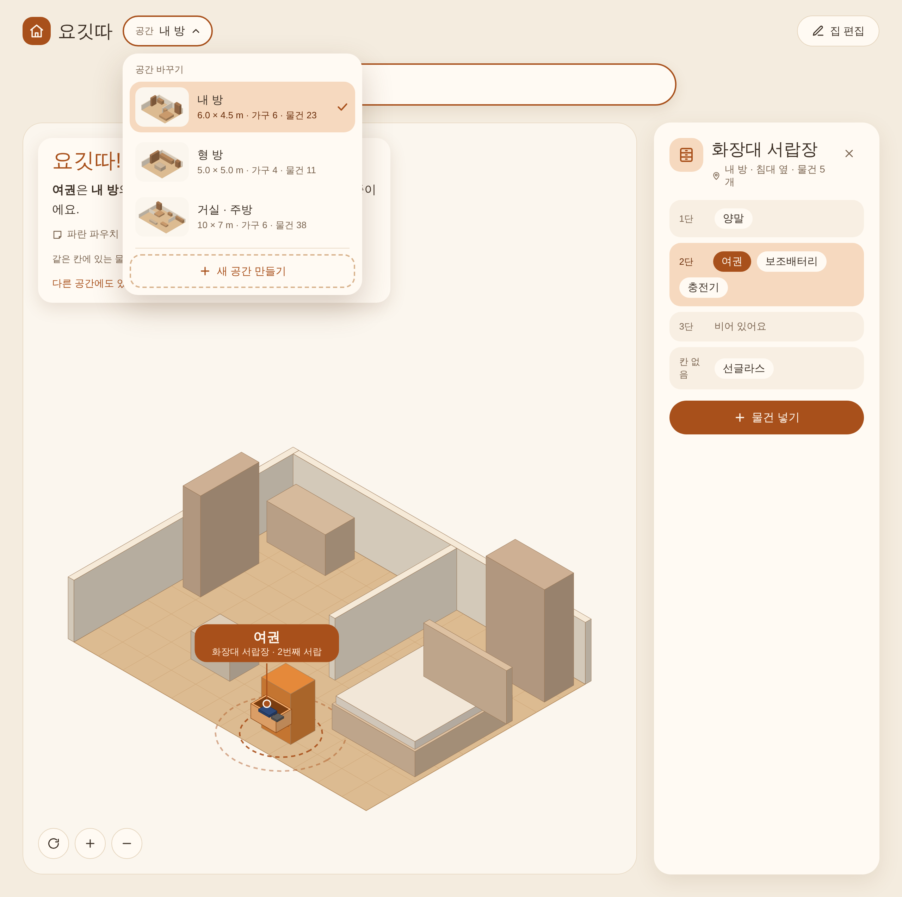
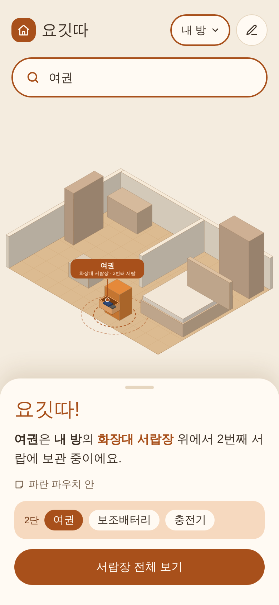
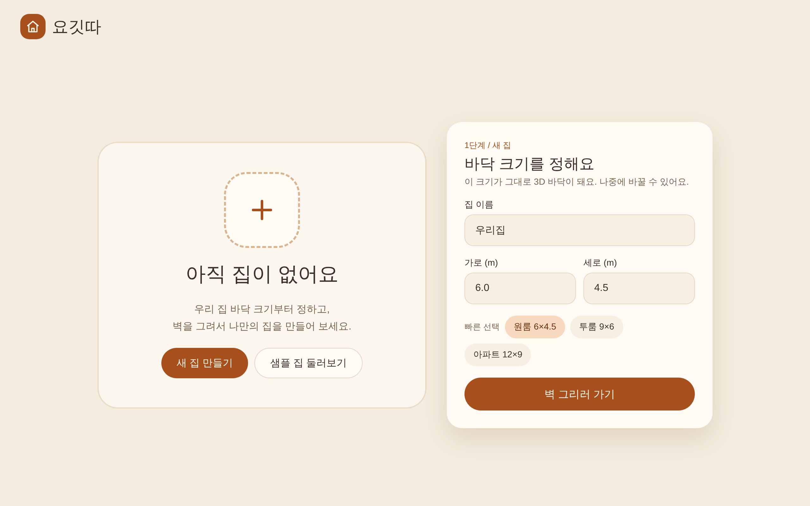
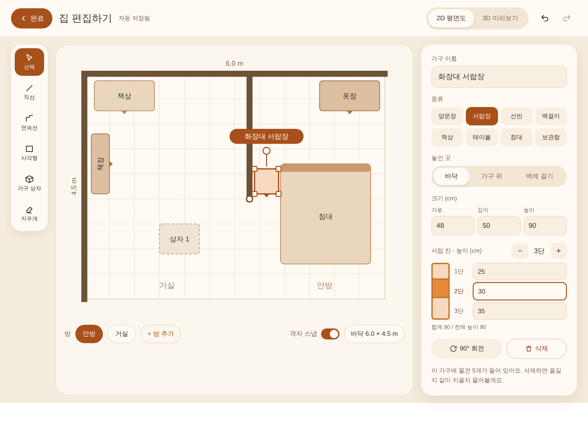
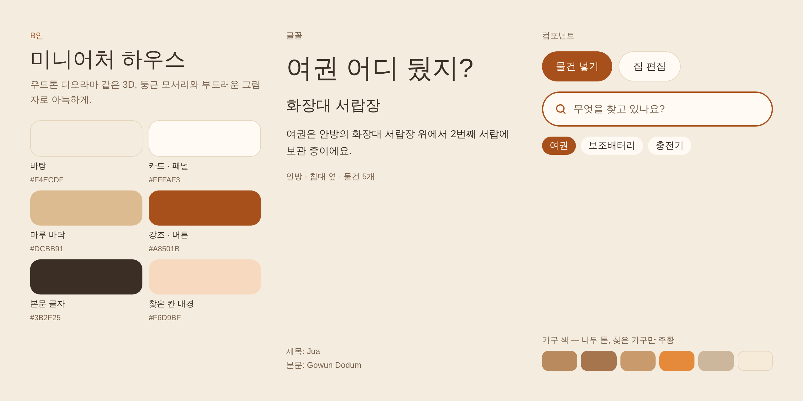

# 요깃따 디자인 레퍼런스

3안(A 건축 도면 / B 미니어처 하우스 / C 미니멀)을 비교한 뒤 **B안 "미니어처 하우스"**로 확정한 시안이다.
화면을 만들 때 이 이미지를 보고 모양을 맞추고, 색·크기 같은 수치는 `yogitta-design` 스킬을 기준으로 한다.

- 원본 디자인보드: https://claude.ai/artifact/NQ1GZsjb9MQAPdQKPutDpn (편집 가능한 원본)
- 원본 HTML: `boards/*.dc.html` (각 화면의 실제 마크업과 인라인 스타일, 수치 확인용)
- 이미지의 글꼴은 대체 글꼴로 캡처됐다. 실제 앱은 제목 Jua, 본문 Gowun Dodum을 쓴다.

## 화면 목록

| # | 파일 | 화면 | 볼 것 |
| --- | --- | --- | --- |
| 01 | `01-main.png` | 메인 화면 | 공간 버튼과 공간 전환 목록(펼친 상태), 검색창, 검색 결과 카드("요깃따!"), 3D 위치 표시(칸 열림·핑·핀·나머지 흐리게), 가구 상세 패널 |
| 02 | `02-mobile.png` | 모바일 메인 화면 | 헤더의 공간 버튼, 검색창, 3D 공간, 하단 시트 검색 결과 |
| 03 | `03-empty.png` | 첫 실행 화면 | 가운데 `+`, 샘플 공간 둘러보기, 바닥 크기 카드(빠른 선택) |
| 04 | `04-edit.png` | 편집 모드 | 그리기 도구, 2D 평면도(치수·정면 표시·선택 핸들), 속성 패널(가구 종류 8개, 놓인 곳, 크기, 칸 높이) |
| 05 | `05-style.png` | 스타일 타일 | 색, 글꼴, 버튼·검색창·칩, 가구 색 |

## 01 메인 화면

## 02 모바일 메인 화면

## 03 첫 실행 화면

## 04 편집 모드

## 05 스타일 타일

## 시안과 용어집이 다른 부분

시안을 만들 때는 용어집이 없어서 일부 문구가 용어집과 다르다. 구현할 때는 **용어집(`glossary.md`)을 따른다.**

| 시안 문구 | 구현할 문구 |
| --- | --- |
| 집 편집 / 집 편집하기 | 편집 / 편집 모드 |
| 아직 집이 없어요, 새 집 만들기, 집 이름 | 아직 공간이 없어요, 새 공간 만들기, 공간 이름 |
| 샘플 집 둘러보기 | 샘플 공간 둘러보기 |
| 가구 상자 (도구) | 가구 |
| 상자 1 | 보관함 1 |
| 방 (하단 목록), + 방 추가 | 구역, + 구역 추가 |
| 양문장 | 양문 수납장 |
| 옷장, 책장 (평면도 라벨) | 양문 수납장, 선반 |
| 1단·2단 (칸 이름) | 1번째 칸… (화면에서는 가구 종류별 표현: 위에서 2번째 서랍) |
