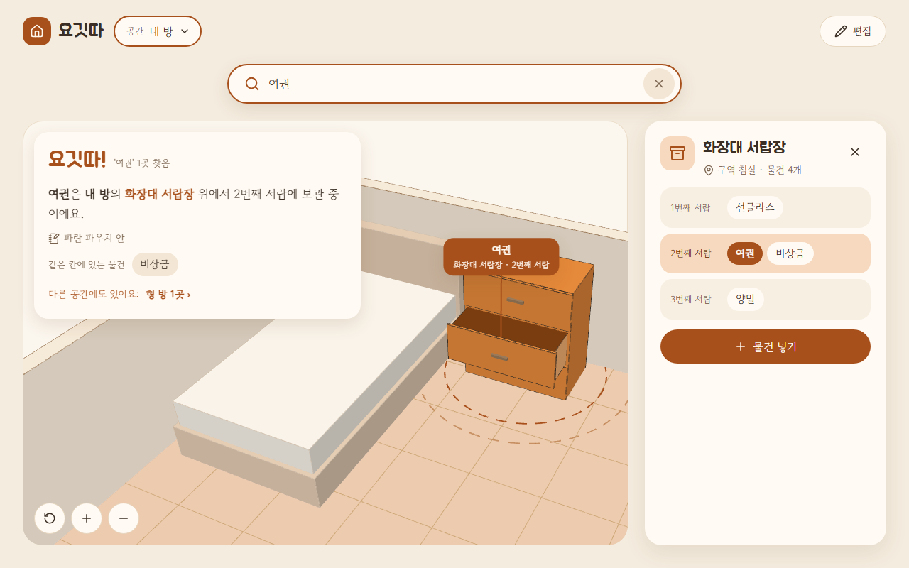
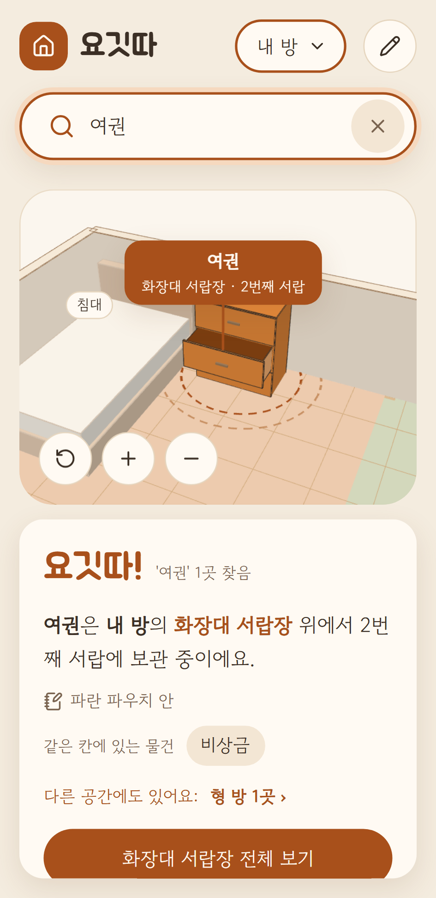
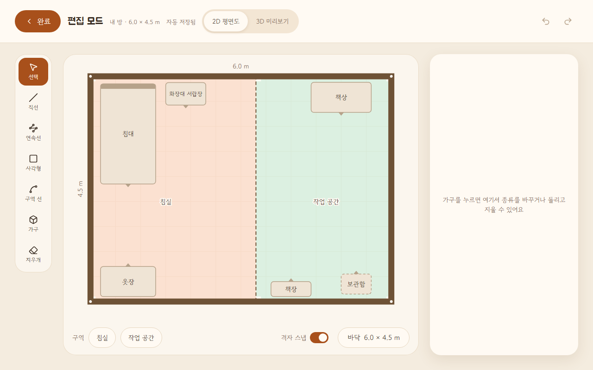
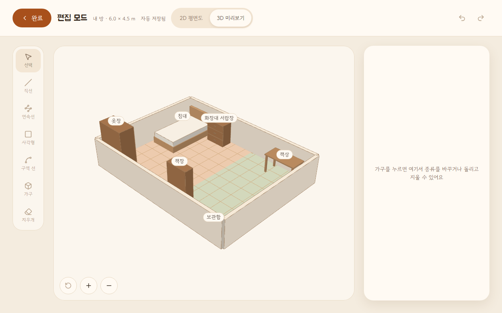

# 요깃따 (Yogitta)

> "여권 어디 뒀더라?" — 내 방을 2D로 그려 3D로 세우고, 물건을 검색하면 그 칸이 열리며 **"요깃따!"** 하고 위치를 보여주는 브라우저 앱이다.

**▶ 바로 써 보기: https://leeeun03-creator.github.io/yogitta/**
처음 열면 샘플 공간(내 방·형 방)이 보인다. 검색창에 "여권"을 쓰면 된다. 설치·가입은 필요 없다.

목차: [1. 제작한 것](#1-제작한-것-소개) · [2. PRD와 Todo 리스트](#2-prd와-todo-리스트) · [3. Todo 변경 내역](#3-todo-리스트의-변경-내역) · [4. 스킬](#4-스킬) · [5. 느낀점과 결론](#5-느낀점과-결론)

---

## 1. 제작한 것 소개

물건이 많은 방에서 "어디 뒀더라?"를 줄이는 앱이다. 내 방 구조와 가구를 한 번 만들어 두고 칸마다 물건을 넣어 두면, 검색 한 번에 "몇 번째 서랍"까지 알려주고 3D에서 그 칸을 열어 보여준다.

| 검색하면 "요깃따!" — 위치 문장, 3D에서 그 칸이 열리고 핀 | 휴대폰 |
|---|---|
|  |  |

| 편집 모드 — 2D 평면도에 벽·구역·가구 그리기 | 편집 모드 — 3D 미리보기 |
|---|---|
|  |  |

**찾기 (핵심)**
- 물건 이름·메모로 검색한다. 띄어쓰기·대소문자는 무시한다 ("겨울패딩" → "작년 겨울 패딩").
- "요깃따!"와 위치 문장을 보여준다: "여권은 내 방의 화장대 서랍장 위에서 2번째 서랍에 보관 중이에요." (은/는 자동)
- 3D에서는 찾은 가구만 강조하고 나머지는 흐리게 한다. 그 칸(서랍·문·선반)이 열리고, 바닥 점선 원과 칸 위 핀이 보이며, 카메라가 그 칸 정면으로 옮겨 간다.
- 같은 칸에 있는 물건 칩(누르면 그 물건 찾기)과 다른 공간 결과 링크를 보여준다.

**공간 만들기**
- 바닥 크기를 정하고 2D 평면도에 벽을 그린다: 직선·연속선·사각형·지우개, 격자·끝점 스냅, 휴대폰은 끌어서 그리기 + 돋보기.
- 구역 선으로 바닥을 나눠 구역(침실·작업 공간)을 만든다. 공간은 여러 개(내 방·형 방) 만들고 바꾼다.
- 가구 8종(양문 수납장·서랍장·선반·벽걸이·책상·테이블·침대·보관함)을 놓고 옮기고 돌린다. 크기·칸 수·칸 높이를 바꾼다.
- 가구 위에 가구를 올린다(책상 위 보관함). 벽걸이는 설치 높이를 정하고 가까운 벽에 붙인다.
- 모든 것을 고칠 수 있고 되돌리기·다시하기가 된다. 2D 평면도 ↔ 3D 미리보기를 오간다.

**물건과 저장**
- 가구 상세 패널에서 칸별로 물건을 넣고 고치고 옮긴다. 칸을 줄이거나 가구를 지우면 물건을 어떻게 할지 먼저 묻는다.
- 브라우저에 자동 저장한다. 깨진 데이터는 안내 후 샘플로 시작하고 원본은 따로 남긴다.
- 백업 파일(JSON)을 내보내고 가져와 다른 기기로 옮긴다. 깨진 파일은 거부한다.

**실행 방법과 기술**

```bash
npm install
npm run dev        # 개발 서버
npm run check      # 타입 · lint · 코드 테스트(Vitest) · 빌드
npm run test:e2e   # 실제 테스트(Playwright, 데스크톱 1280 · 휴대폰 360)
```

Vite · React · TypeScript · React Three Fiber(three.js) · drei · zustand · Vitest · Playwright. push하면 GitHub Actions가 검사 → 실제 테스트 → GitHub Pages 배포 → 배포 주소에서 실제 테스트를 다시 돌린다. 서버 없이 브라우저만으로 동작한다.

---

## 2. PRD와 Todo 리스트

### PRD

전체 문서: [docs/PRD.md](docs/PRD.md) (개요·문제 정의·목표·타깃 사용자·유저 스토리·기능·인수 조건) · 기획서: [docs/기획서.md](docs/기획서.md)

- **문제:** 물건이 많은 방에서 어디 뒀는지 기억나지 않아 서랍을 다 열어 본다.
- **주 사용자:** 원룸에 수납장·서랍장·선반이 빽빽한 자취생. 부 사용자는 형제와 사는 사람, 링크만 받아 바로 확인하는 과제 평가자다.
- **핵심 경험:** 검색 한 번 → "요깃따!" + 위치 문장 + 3D에서 그 칸이 열림.

| 기능 | 내용 | 우선순위 | 결과 |
|---|---|---|---|
| F1 | 새 공간의 바닥 크기 = 3D 바닥 | P0 | ✅ |
| F2 | 그리기 도구: 직선·연속선·사각형·지우개 | P0 | ✅ |
| F3 | 2D 선분 → 3D 벽, 2D 평면도 / 3D 미리보기 전환 | P0 | ✅ |
| F4·F5 | 가구 배치(이동·회전·정면), 종류 8종으로 모양 변신 | P0 | ✅ |
| F6 | 가구 이름 중복 불가, 구역 선으로 구역 나누기 | P0 | ✅ |
| F7 | 물건 등록: 이름 + 칸 + 메모 | P0 | ✅ |
| F8·F9 | 검색(부분 일치·띄어쓰기 무시), "요깃따!" + 위치 문장 | P0 | ✅ |
| F10 | 3D 위치 표시: 칸 열림·흐리게·바닥 핑·핀 | P0 | ✅ |
| F11 | 3D 가구 누르기 → 가구 상세 패널 | P0 | ✅ |
| F12 | 공간 여러 개 + 공간 전환 | P0 | ✅ |
| F13 | 모든 구조·물건 수정 + 되돌리기/다시하기 | P0 | ✅ |
| F14 | 자동 저장 + 첫 접속 샘플 공간 | P0 | ✅ |
| F18 | 격자·끝점 스냅 | P0 | ✅ |
| F15 | 가구 위 가구 | P1 | ✅ |
| F16 | 칸 높이 입력, 벽걸이 설치 높이·벽에 붙이기 | P1 | ✅ |
| F17 | 같은 칸 물건, 다른 공간 결과 링크 | P1 | ✅ |
| F19 | 백업 파일 내보내기 / 가져오기 | P1 | ✅ |
| F20 | 원·곡선 벽, 문·창문, 초성 검색, 상대 위치 | P2 | 하지 않음 (여유 있으면) |

### Todo 리스트

전체: [docs/TODO.md](docs/TODO.md) · 큰 Todo마다 세부 Todo: [docs/todo/](docs/todo/) (`T1.md` …)

PRD 기능 → 큰 Todo(`Tn`) → 세부 Todo(`Tn-n`)로 나눴다. 세부 Todo 하나가 커밋 하나다. 만드는 순서(의존)대로 챕터 7개로 묶었고, **큰 Todo 24개 · 세부 Todo 101개를 모두 끝냈다.**

| 챕터 (목표) | 큰 Todo |
|---|---|
| 1. 기반 — 배포된 빈 2D 평면도 | T1 프로젝트 세팅·배포 · T2 새 공간과 2D 평면도 격자 |
| 2. 벽과 3D — 그린 벽이 3D로 선다 | T3 벽 그리기 도구 · T12 스냅 · T31 터치로 벽 그리기 · T13 되돌리기 · T4 3D로 세우기 |
| 3. 공간 — 구역·공간 관리 | T5 구역 선으로 구역 나누기 · T25 메인 화면과 편집 모드 · T27 공간 여러 개 |
| 4. 가구 — 가구 놓고 모양 바꾸기 | T6 가구 놓기·옮기기·돌리기 · T7 가구 종류 8종 · T26 벽·가구·바닥 고치기 |
| 5. 물건과 저장 — 칸별 물건, 자동 저장 | T8 칸별 물건 · T9 3D에서 가구 누르기 · T16 물건 옮기기·지키기 · T11 자동 저장·샘플 공간 |
| 6. 찾기 — **P0 완료 = 제출 가능** | T10 "요깃따!"와 위치 문장 · T28 3D 위치 표시 · T15 카메라를 칸 정면으로 |
| 7. 다듬기 (P1) | T29 가구 위 가구 · T30 칸 높이·벽걸이 · T14 같은 칸 물건 · T17 백업 파일 · README |

세부 Todo마다 완료 조건(통과해야 할 테스트)과 결과를 적었고, 큰 Todo가 끝나면 사용자가 직접 확인할 체크리스트를 붙였다 (예: [docs/todo/T28.md](docs/todo/T28.md)).

---

## 3. Todo 리스트의 변경 내역

처음 계획은 [기획서 6장](docs/기획서.md)(1·2·3순위 + 일주일 일정)이다. 개발하면서 바뀐 것은 코드와 따로 `todo:` 커밋으로 남기고, 이유는 [변경 로그](docs/todo/log/)에 큰 Todo별로 적었다 (여러 큰 Todo에 걸친 것은 [`log/전체.md`](docs/todo/log/전체.md)).

### 처음 계획과 비교

| 구분 | 처음 계획 (기획서 6장) | 최종 | 이유 |
|---|---|---|---|
| **새로 넣음** | — | **T31 터치에서도 편하게 벽 그리기** (끌어서 그리기·돋보기·길이 표시, P0) | 휴대폰에서 두 번 누르기가 번거롭고 손가락이 찍을 자리를 가림 (사용자 요청) |
| **새로 넣음** | T25 메인 화면은 1순위에 있었지만 일정에 빠짐 | **T25 메인 화면 틀**을 챕터 3에 배치 | T27(공간 전환)이 메인 화면을 필요로 함 |
| **새로 넣었다가 합침** | T5 구역 목록 관리(추가·이름·삭제) | 구역 선 기능을 T32로 따로 넣음 → **T5에 합쳐 "구역 선으로 바닥을 나눠 구역 만들기"로 고침** | 이름만 있는 구역은 화면에 표시가 없음. 사용자는 T5를 고쳐서 하는 것으로 이해했음 |
| **나눠서 옮김** | T20 각도 고정·길이 표시·점 드래그 편집 (3순위) | 길이 표시 → T31, 점 드래그 → T26으로 옮기고 **T20은 각도 고정만 남음** | 그리기 도구·고치기와 함께 있어야 쓸모가 있음 |
| **올림** | T12 스냅 (2순위) | **P0**, 벽 도구 바로 다음 | 직선을 써 보니 집 구조라 벽 끝이 끊기면 이상함 (사용자 요청) |
| **올림** | T13 되돌리기 (2순위) | **P0**, 챕터 2(벽 도구 다음) | 그리다 틀리면 바로 Ctrl+Z가 필요함 (사용자 요청) |
| **올림** | T28 3D 위치 표시 · T15 카메라 이동 · T16 물건 지키기 (2순위) | **P0** | PRD에서 3D 위치 표시(F10)가 P0이고, 칸 수 감소·가구 삭제 때 물건 처리가 P0 인수 조건에 있음 |
| **내림** | T29 가구 위 가구 · T30 칸 높이 (1순위) | **P1** (챕터 7) | PRD에서 가구 위 가구(F15)·칸 높이(F16)가 P1이라서 |
| **그대로 P1** | T14 같은 칸 물건 · T17 백업 파일 (2순위) | P1, 모두 끝냄 | |
| **뺌 (여유 있으면)** | T18 벽 이음새·반투명 (2순위) | **P2**로 내리고 하지 않음 | PRD 우선순위에서 핵심 흐름에 꼭 필요하지 않음 |
| **뺌 (여유 있으면)** | T19~T24 원·곡선, 각도 고정, 상대 위치, 초성 검색, 문·창문, 가구 종류 추가 (3순위) | **P2**, 하지 않음 | 처음 계획대로 3순위는 여유가 있을 때만 |
| **일정** | 일주일 일정(1일차 T1·T2 … 7일차 버그 수정·README) | 일차·예상 시간을 빼고 **만드는 순서(의존) 챕터 7개**로 | 일정보다 의존 순서가 중요하고, 챕터마다 도달할 목표가 보이게 |

### 기능을 고친 것 (만들면서 · 테스트와 직접 확인 뒤)

| Todo | 처음 | 바뀐 것 | 계기 |
|---|---|---|---|
| T6 가구 | 바닥 밖으로만 못 나감 | **벽을 뚫거나 다른 가구와 겹치지 않게** 막음 (T6-7·T6-8 추가) | 직접 확인에서 가구가 벽을 지나가고 서로 겹침 |
| T6 가구 | 그은 벽이 가구와 겹치면 알리기만 | **가구에 파고드는 벽은 그어지지 않음** (버그수정) | 직접 확인 |
| T6 가구 | 가구마다 구역을 골라 저장 | **놓인 구획에서 구역을 계산** (저장하지 않음) | 구역 선을 고칠 때마다 가구를 맞출 필요가 없게 |
| T5 구역 | 구역 선 끝이 벽에 안 닿으면 그대로 | **벽 쪽으로 늘려 닿게**, 구역 선 도구로도 구획을 누를 수 있게 (버그수정 2) | 직접 확인에서 바닥이 안 나뉘고 눌러도 반응 없음 |
| T5 구역 | 구역 칩 목록이 다 보임 | **두 줄까지만 보이고 안에서 넘김** (버그수정) | 휴대폰에서 구역이 많으면 2D 평면도가 납작해짐 |
| T7 종류 | 휴대폰도 4열 두 줄 | **한 줄 넘겨 보기** | 스크린샷에서 속성 패널이 2D 평면도를 절반 가림 |
| T2 첫 화면 | 버튼을 눌러 바닥 크기 카드 열기 | **첫 실행 카드와 처음부터 같이** | 시안 03, 한 화면에서 바로 입력 |
| T4 3D | 보기 버튼 없음 | **처음 보기·확대·축소 버튼** 추가 | 시안 01, 휠·두 손가락 없이도 확대 |
| T31 길이 | 소수 한 자리 | **바닥 크기와 같은 규칙**(10cm 아래도 보임) | 짧은 벽은 실제 길이를 알 수 없었음 |
| T15 카메라 | 가구에만 맞춰 당김 | **가구 위 핀까지 감싸게** (버그수정) | 배포 확인 스크린샷에서 작은 가구의 핀 라벨이 잘림 |
| T29 가구 위 가구 | 가구끼리는 늘 막음 | **높이가 겹칠 때만 막음** (벽걸이 아래·받침 가구 위 허용) | 가구를 올리려면 바닥 모양이 겹쳐야 함 |

### Todo를 다루는 방식이 바뀐 것

- Todo를 README 한 파일에 적다가 → `docs/TODO.md`(큰 Todo) · `docs/todo/Tn.md`(세부 Todo) · `docs/todo/log/`(변경 기록)로 나눴다.
- 세부 Todo를 많게는 8개까지 나누다가 → 큰 Todo 하나에 3~4개로 정했다.
- 테스트 규칙: 처음엔 "엣지 케이스까지 실제 테스트, 데스크톱·휴대폰 둘 다, 큰 Todo마다 전체"였다 → 테스트가 900번 넘게 돌아 로컬은 바뀐 기능만, 전체는 CI로 바꿨다 (아래 시행착오).

### 시행착오

**스킬**
- 처음엔 스킬 5개에 규칙을 다 넣었다 → 200~340줄로 길어져 매번 전부 읽어야 했다 → 목차 + 작은 스킬 16개로 나눴다
- 나눈 직후 디자인 토큰 테스트가 옛 스킬 파일을 읽다가 CI가 실패해 배포가 멈췄다 → 읽는 경로를 고쳤다
- "함수 40줄" 규칙을 lint가 막지 않아 두 번 넘겼다(T6, T26) → 커밋 전 자가 점검에서 길이를 본다

**Todo**
- 일차·예상 시간으로 짰다가 하루 단위로 맞지 않아 의존 순서 챕터로 바꿨다
- 구역 선 기능을 새 큰 Todo(T32)로 넣었는데, 뜻은 T5를 고치는 것이었다 → T5에 합쳤다
- 직접 확인에서 나온 요청으로 Todo가 늘었다(벽·가구 겹침 막기, 휴대폰 끌어서 그리기)

**테스트**
- "엣지 케이스까지, 데스크톱·휴대폰 둘 다" 규칙으로 실제 테스트가 509개 × 2화면 ≈ 900번이 됐다. 한 번에 10~17분, 컴퓨터가 뜨거워지고 토큰도 많이 들었다 → 로컬은 바뀐 기능만, 전체는 CI에 맡겼다
- 연달아 push하면 CI가 앞 실행을 취소해, 한동안 전체 테스트가 끝까지 돌지 않았다 → 문제를 늦게 알았다
- 로컬에선 되고 느린 CI에서만 실패한 테스트가 있었다(돋보기, T31-3) → 화면이 바뀔 때까지 기다리게 고쳤다
- 테스트가 진짜 버그를 잡기도 했다: 결과 카드에서 화면이 멈춤, 작은 가구를 찾으면 핀 라벨이 잘림, 카메라가 옮겨 가는 중 [처음 보기]가 무시됨

커밋 로그로 직접 보려면 (커밋 190개: 세부 Todo 115 · `todo:` 35 · `chore:` 21 · 버그수정 5 · 오류수정 2 · `skill:` 5 · `docs:` 7):

```bash
git log --pretty=format:"%ad | %s" --date=short --grep="^todo:"          # Todo 변경
git log --pretty=format:"%ad | %s" --date=short --grep="버그수정\|오류수정"  # 고친 것
git log --pretty=format:"%s" --grep="^T29-"                              # 한 큰 Todo의 작업
```

---

## 4. 스킬

Claude Code로 개발하면서 프로젝트 규칙을 [`.claude/skills/`](.claude/skills/)에 **직접 만든 스킬**로 두었다. [`CLAUDE.md`](CLAUDE.md)의 "항상 지킬 것"에 언제 어떤 스킬을 읽을지 정해 두었다.

### 왜 직접 만들었나

- AI와 여러 세션에 걸쳐 작업하면 세션마다 폴더 구조·용어·커밋 형식이 달라진다. 규칙을 스킬로 적어 두면 새 세션도 같은 규칙으로 시작한다.
- 과제 조건(Todo로 중간중간 커밋, 커밋에 무엇을 했는지 보이게)을 매번 말하지 않아도 지키게 하려고.
- 디자인 시안(B안 "미니어처 하우스")의 색·크기·모양을 화면마다 똑같이 맞추려고.
- 처음엔 스킬 5개에 모든 규칙을 넣었다. 본문이 200~340줄로 길어져서 지금은 **큰 스킬은 목차, 본문은 작은 스킬**로 나눴다. 큰 스킬을 읽고 지금 하는 일에 맞는 작은 스킬만 불러 읽는다.

### 스킬과 작업에서 쓰인 곳

| 큰 스킬 | 언제 읽나 | 만든 이유 | 작업에서 쓰인 곳 |
|---|---|---|---|
| `yogitta-todo` | 세션 시작, 큰 Todo 시작, 세부 Todo 끝 | Todo를 바로 시작할 크기로 쪼개고, 바뀐 이유를 남기려고 | 큰 Todo 24개를 세부 Todo 101개로 나눔, 세션마다 "지금·다음·막힌 것" 3줄 보고, `todo:` 커밋 35개와 변경 로그 |
| `yogitta-code` | 코드를 쓰거나 고치기 전 | 기능을 고쳐도 다른 기능이 안 깨지게 구조를 고정하려고 | feature 폴더(`spaces`·`editor2d`·`scene3d`·`furniture`·`items`·`search`·`storage`), 파일 200줄·함수 40줄, 큰 Todo마다 정리 점검(`chore:` 21개) |
| `yogitta-design` | 화면·3D 색을 다룰 때 | 시안의 색·크기·모양을 화면마다 같게 | 색 토큰(`tokens.css`), 결과 카드 순서(요깃따! → 문장 → 메모 → 같은 칸 → 다른 공간), 3D 위치 표시 순서, 시안과 스크린샷 비교 |
| `yogitta-test` | 세부 Todo 계획, 커밋 전 | "테스트 통과 = 완료"로 끝을 분명히 | 코드 테스트(Vitest) 800여 개, 실제 테스트(Playwright), 큰 Todo 끝 직접 확인 체크리스트. 뒤에 "꼭 필요한 만큼만"으로 고침 |
| `commit-convention` | 커밋 전 | 커밋 로그만 봐도 어떤 Todo의 몇 번째 작업인지 보이게 | `Tn-n: …`, `Tn-n 버그수정[영역]: …`, `todo:`·`chore:`·`skill:` 머리말 |

용어집([`glossary.md`](.claude/skills/yogitta-code/glossary.md))을 두어 주석·문서·커밋에서 같은 것을 같은 말로 쓰게 했다 (예: "방" → "공간"·"구역", "슬롯" → "칸").

### SKILL.md 내용

큰 스킬 5개의 SKILL.md 전문이다 (눌러서 펼치기). 각 큰 스킬의 본문 장은 아래 작은 스킬에 장 번호 그대로 있다.

<details>
<summary><code>yogitta-todo</code> — Todo 규칙 (<a href=".claude/skills/yogitta-todo/SKILL.md">파일</a>)</summary>

````markdown
---
name: yogitta-todo
description: 요깃따에서 세션을 시작할 때, 큰 Todo를 시작할 때, 세부 Todo를 끝낼 때, Todo를 바꾸거나 고친 것을 기록할 때, 하루를 마칠 때 항상 먼저 읽는다. Todo 규칙의 목차다.
---

# 요깃따 Todo 규칙 (목차)

Todo는 "할 일을 적는 것"보다 **바로 시작할 수 있는 단위로 쪼개는 것**이 핵심이다.
PRD 기능(F) → 유저 스토리(US) → 큰 Todo(`Tn`) → 세부 Todo(`Tn-n`) 순서로 내려간다.

함께 쓰는 스킬
- 완료 기준·테스트 → `yogitta-test`
- 번호 규칙·커밋 형식 → `commit-convention`
- 용어 → `yogitta-code/glossary.md` (목표, 오늘 할 일, 큰 Todo, 세부 Todo, 세부 Todo 파일)

---

## 목차 — 하는 일에 맞는 작은 스킬을 부른다

이 스킬은 목차다. 아래에서 지금 하는 일에 맞는 작은 스킬을 **Skill 도구로 불러** 읽고 따른다.
다른 스킬에 있는 "`yogitta-todo` N장" 같은 참조도 이 표에서 장 번호로 찾는다.

| 장 | 다루는 것 | 부를 스킬 |
|---|---|---|
| 1~2장 | 파일 구조, 시작할 때 읽는 순서와 3줄 보고 | `yogitta-todo-start` |
| 3~5장 | 큰 Todo·세부 Todo 쓰는 법, 체크할 때 | `yogitta-todo-write` |
| 6~7장 | 바뀔 때 로그 쓰기, 목표·오늘 할 일·하루 마무리 | `yogitta-todo-log` |
| 8장 | 이 스킬에 그대로 있다 (아래) | — |

---

## 8. 하지 말 것

- 목표를 할 일로 적기 ("검색 잘 되게 하기" ✗ → "검색어 띄어쓰기 무시하기" ✓)
- 완료 조건 없이 세부 Todo 적기
- 큰 Todo를 세부 Todo 5개 넘게 잘게 쪼개기, 쪼개지 않고 시작하기
- 같은 체크박스를 두 파일에 두기
- 변경 기록을 `docs/TODO.md`나 세부 Todo 파일에 적기 (기록은 `docs/todo/log/`에만)
- 테스트를 통과하지 않았는데 체크하기
- 세부 Todo를 적지 않고 큰 Todo 작업 시작하기
````

</details>

<details>
<summary><code>yogitta-code</code> — 코드 작성 규칙 (<a href=".claude/skills/yogitta-code/SKILL.md">파일</a>)</summary>

````markdown
---
name: yogitta-code
description: 요깃따 코드를 새로 쓰거나 고치기 전에 항상 먼저 읽는다. 코드 규칙의 목차라 여기서 맞는 작은 스킬(구조·모양·엣지 케이스·작업 흐름)로 간다.
---

# 요깃따 코드 작성 규칙 (목차)

목표: 프로젝트가 커져도 **어디에 뭐가 있는지 바로 알고**, 한 기능을 고쳐도 **다른 기능이 안 깨지는** 코드.
기술 스택: Vite + React + TypeScript, React Three Fiber + drei, zustand, Vitest.

함께 쓰는 스킬
- 색·컴포넌트 모양 → `yogitta-design`
- 커밋 메시지·타이밍 → `commit-convention`
- 테스트 항목·완료 기준 → `yogitta-test`

---

## 목차 — 하는 일에 맞는 작은 스킬을 부른다

이 스킬은 목차다. 아래에서 지금 하는 일에 맞는 작은 스킬을 **Skill 도구로 불러** 읽고 따른다.
다른 스킬에 있는 "`yogitta-code` N장" 같은 참조도 이 표에서 장 번호로 찾는다.

| 장 | 다루는 것 | 부를 스킬 |
|---|---|---|
| 1~3장 | 파일 위치·import·store | `yogitta-code-structure` |
| 4~8장 | 이름·크기·타입·상수·주석·용어 | `yogitta-code-style` |
| 9~10장 | 빈 상태·오류 처리, 검사 도구 | `yogitta-code-safety` |
| 11~13장 | 계획 → 작성 → 자가 점검 → 검사 → 커밋, 정리 점검 | `yogitta-code-workflow` |

## 늘 지킬 것 (작은 스킬을 부르기 전에도)

- 기능(feature) 단위 폴더. 다른 feature는 `index.ts`로만, 경로는 `@/`
- 계산은 `logic`·`shared/lib`의 순수 함수로, 데이터 변경은 store 액션으로만
- 파일 200줄·함수 40줄, `any`·`as`(`as const` 빼고) 금지, 한 파일에 대표 export 하나
- 주석·문서·커밋의 용어는 `.claude/skills/yogitta-code/glossary.md`만 쓴다
````

</details>

<details>
<summary><code>yogitta-design</code> — 디자인 규칙 (<a href=".claude/skills/yogitta-design/SKILL.md">파일</a>)</summary>

````markdown
---
name: yogitta-design
description: 요깃따 화면·컴포넌트·스타일·3D 색을 만들거나 고칠 때 항상 먼저 읽는다. 시안 이미지(references) 목록과 디자인 규칙의 목차가 여기 있다.
---

# 요깃따 디자인 규칙 (B안 · 미니어처 하우스, 목차)

요깃따의 모든 화면은 이 문서를 따른다. 우드톤 디오라마 같은 3D, 완전히 둥근 버튼, 부드러운 그림자로 **아늑한 미니어처 집** 느낌을 낸다.
레퍼런스는 이 스킬의 `references/` 폴더에 있다. 화면을 만들기 전에 **해당 이미지를 열어** 모양을 맞추고, 수치(색·크기·모서리)는 이 문서를 기준으로 한다.

---

## 목차 — 하는 일에 맞는 작은 스킬을 부른다

이 스킬은 목차다. 아래에서 지금 하는 일에 맞는 작은 스킬을 **Skill 도구로 불러** 읽고 따른다.
다른 스킬에 있는 "`yogitta-design` N장" 같은 참조도 이 표에서 장 번호로 찾는다.

| 장 | 다루는 것 | 부를 스킬 |
|---|---|---|
| 1~3장 | 색 토큰, 글꼴, 아이콘 | `yogitta-design-tokens` |
| 4장 | 버튼·검색창·칩·결과 카드·패널·드롭다운·편집 모드·입력칸 | `yogitta-design-components` |
| 5~6장 | 3D 색·위치 표시·가구 누르기, 2D 평면도 | `yogitta-design-scene` |
| 7~10장 | 화면 배치, 문구 톤, 접근성, 파일 위치 | `yogitta-design-layout` |
| 0·11장 | 이 스킬에 그대로 있다 (아래) | — |

---

## 레퍼런스

| 만들 화면 | 열어볼 이미지 | 수치 확인용 원본 HTML |
|---|---|---|
| 메인 화면 (공간 전환 목록, 검색창, 검색 결과 카드, 3D 위치 표시, 가구 상세 패널) | `references/01-main.png` | `references/boards/01-main.dc.html` |
| 모바일 메인 화면 (하단 시트) | `references/02-mobile.png` | `references/boards/02-mobile.dc.html` |
| 첫 실행 화면 (점선 `+` 카드, 바닥 크기 카드, 빠른 선택) | `references/03-empty.png` | `references/boards/03-empty.dc.html` |
| 편집 모드 (그리기 도구, 2D 평면도, 속성 패널, 구역 목록) | `references/04-edit.png` | `references/boards/04-edit.dc.html` |
| 색·글꼴·버튼·칩 (스타일 타일) | `references/05-style.png` | `references/boards/05-style.dc.html` |
| 컴포넌트 · 버튼 · 입력 (상태별) | `references/06-components-actions.png` | `references/boards/06-components-actions.dc.html` |
| 컴포넌트 · 검색창 · 칩 · 검색 결과 카드 · 위치 문장 규칙 | `references/07-components-search.png` | `references/boards/07-components-search.dc.html` |
| 컴포넌트 · 칸 행 · 가구 상세 패널 · 공간 전환 목록 · 그리기 도구 · 가구 종류 선택 | `references/08-components-panels.png` | `references/boards/08-components-panels.dc.html` |

- 시안 문구 중 용어집과 다른 것(집 → 공간, 상자 → 보관함, 방 → 구역, 1단 → 1번째 칸 등)은 `references/README.md`의 "시안과 용어집이 다른 부분" 표대로 바꿔서 쓴다
- 이미지의 글꼴은 대체 글꼴로 캡처됐다. 실제 앱은 Jua·Gowun Dodum
- 실제 테스트 스크린샷(`yogitta-test` 5장)은 이 이미지와 눈으로 비교한다

---

## 0. 작업 전 체크

1. 만들 화면의 레퍼런스 이미지를 연다 (위 표)
2. 새 색을 만들지 말고 아래 토큰만 쓴다 (`var(--yg-…)`)
3. 글꼴은 제목 Jua, 본문 Gowun Dodum 두 개뿐
4. 버튼·검색창·칩은 알약형, 카드·패널은 둥근 모서리 + 부드러운 그림자
5. 3D에서 강조색은 "찾은 가구" 하나에만 쓴다
6. 끝나면 "11. 하지 말 것"을 다시 확인한다

---

## 11. 하지 말 것

- 토큰에 없는 색, 그라데이션 배경, 네온·보라 계열
- 각진 버튼(4px 이하 모서리), 진한 그림자
- 3D에 텍스처·사실적인 재질·여러 강조색
- 이모지 아이콘
- "요깃따!"를 찾지 못한 상황이나 다른 곳에 쓰는 것 (찾았을 때만)
````

</details>

<details>
<summary><code>yogitta-test</code> — 테스트 규칙 (<a href=".claude/skills/yogitta-test/SKILL.md">파일</a>)</summary>

````markdown
---
name: yogitta-test
description: 요깃따 세부 Todo 계획을 세울 때와 커밋하기 전에 항상 먼저 읽는다. 테스트 규칙의 목차다.
---

# 요깃따 테스트 규칙 (목차)

세부 Todo마다 테스트 내용은 다르다. 이 스킬은 **모든 세부 Todo에 똑같이 적용하는 공통 규칙**이다.

**기준은 "기능이 제대로 동작하는가"다.** 테스트는 그것을 확인할 만큼만 쓴다. 같은 것을 여러 번 확인하거나, 느낌·모양처럼 사람이 직접 볼 것을 자동 테스트로 늘리지 않는다 (테스트가 많으면 시간과 토큰만 든다).
용어는 `yogitta-code/glossary.md`를 따른다 (코드 테스트, 실제 테스트, 배포 확인, 직접 확인, 엣지 케이스, 완료).

함께 쓰는 스킬
- 작업 흐름 전체 → `yogitta-code` 11장 (이 스킬은 그중 ①계획의 테스트 항목과 ④검사를 맡는다)
- 커밋 → `commit-convention`

---

## 목차 — 하는 일에 맞는 작은 스킬을 부른다

이 스킬은 목차다. 아래에서 지금 하는 일에 맞는 작은 스킬을 **Skill 도구로 불러** 읽고 따른다.
다른 스킬에 있는 "`yogitta-test` N장" 같은 참조도 이 표에서 장 번호로 찾는다.

| 장 | 다루는 것 | 부를 스킬 |
|---|---|---|
| 3~5장 | 테스트 항목 정하기, 엣지 케이스, 코드·실제 테스트 쓰는 법 | `yogitta-test-write` |
| 6장 | 큰 Todo 끝 직접 확인 체크리스트 | `yogitta-test-check` |
| 1·2·7·8·9장 | 이 스킬에 그대로 있다 (아래) | — |

---

## 1. 완료 기준

세부 Todo는 **아래를 모두 통과해야 완료**다. 완료 전에는 `docs/todo/Tn.md`에 체크하지 않는다 (`yogitta-todo` 5장).

| # | 검사 | 명령 | 언제 |
|---|---|---|---|
| 1 | 코드 테스트 + 타입·lint·빌드 | `npm run check` | 매 세부 Todo |
| 2 | 실제 테스트 | 바뀐 기능의 spec만 `npx playwright test e2e/… --project=desktop` | 매 세부 Todo. 휴대폰 화면·터치가 바뀌었을 때만 `--project=mobile`도. **전체는 로컬에서 돌리지 않는다** (3의 CI가 돌린다) |
| 3 | 배포 확인 | push 후 GitHub Actions의 `verify` 잡 통과 | 매 push |
| 4 | 직접 확인 | 사용자가 체크리스트(6장)로 확인 | 큰 Todo(Tn) 끝 |

- 망가뜨리기 확인(일부러 고장 내 보기)은 하지 않는다
- 1·2가 통과해야 커밋한다. 3(CI의 실제 테스트 전체)이 실패하면 바로 고친다 (`Tn-n 오류수정[빌드]` 등)
- 체크박스는 1·2를 통과한 커밋에 함께 넣는다

---

## 2. 다음 작업으로 넘어가는 조건

- 지금 세부 Todo의 테스트가 **모두 통과해야** 다음 세부 Todo로 넘어간다
- **예외**: 지금 Todo를 테스트하려면 다음 Todo가 꼭 있어야 할 때만 (예: store 액션은 화면이 생겨야 실제 테스트 가능)
  - 이때는 계획에 "실제 테스트는 Tn-m에서 함께"라고 적고, 코드 테스트는 지금 통과시킨다
  - 미룬 테스트는 그 Todo에서 반드시 채운다. 미룬 채로 큰 Todo를 끝내지 않는다
- 실패한 테스트를 지우거나 `skip`으로 통과시키지 않는다. `skip`은 환경 때문에 못 돌 때만, 이유 주석과 함께 (예: 배포 주소에서만 되는 검사)

---

## 7. 실패했을 때

1. 테스트가 맞고 코드가 틀림 → 코드를 고치고 `Tn-n 버그수정[영역]` / `Tn-n 오류수정[영역]` 커밋 (`commit-convention` 5장)
2. 테스트가 틀림 (환경 차이, 잘못된 기대값) → 이유를 사용자에게 말하고 테스트를 고친다. 이유는 테스트 주석에 남긴다
3. 원인을 모름 → 추측으로 고치지 않고, 재현 → 원인 확인 → 수정 순서로 간다

---

## 8. 보고

세부 Todo를 끝낼 때 보고에 테스트 결과를 한 줄로 넣는다.

```
테스트: 코드 12개 통과 · 실제 2개 통과(데스크톱)
```

---

## 9. 하지 말 것

- 테스트를 안 돌리고 체크박스 체크, 커밋
- 실패한 테스트 삭제·`skip`으로 통과시키기
- 로컬에서 실제 테스트 전체 돌리기, 망가뜨리기 확인, 같은 것을 코드 테스트와 실제 테스트로 두 번 확인하기
- 테스트 때문에 화면 코드에 테스트 전용 분기 넣기
````

</details>

<details>
<summary><code>commit-convention</code> — 커밋 규칙 (<a href=".claude/skills/commit-convention/SKILL.md">파일</a>)</summary>

````markdown
---
name: commit-convention
description: 요깃따 저장소에서 git commit이나 push를 하기 전에 항상 먼저 읽는다. 커밋 규칙의 목차다.
---

# 요깃따 커밋 규칙 (목차)

과제 조건 두 가지를 지키기 위한 스킬이다.
- 다 만들고 한 번에 push하지 말고, **Todo로 작업하는 중간중간 push**
- 커밋 내역에 **무엇을 했는지가 반드시 보이게**

그래서 커밋 단위는 **세부 Todo(Tn-n) 하나**다. 커밋 로그만 봐도 어떤 Todo의 몇 번째 작업을 했는지 보이고, `docs/todo/log/`의 Todo 변경 로그를 커밋 로그에서 바로 정리할 수 있어야 한다.

---

## 목차 — 하는 일에 맞는 작은 스킬을 부른다

이 스킬은 목차다. 아래에서 지금 하는 일에 맞는 작은 스킬을 **Skill 도구로 불러** 읽고 따른다.
다른 스킬에 있는 "`commit-convention` N장" 같은 참조도 이 표에서 장 번호로 찾는다.

| 장 | 다루는 것 | 부를 스킬 |
|---|---|---|
| 1·3·4장 | Todo 번호, 메시지 형식·머리말, 예시 | `commit-message` |
| 5장 | 버그수정·오류수정 구분, 형식, 영역 | `commit-fix` |
| 2·6·7·8장 | 언제 커밋하나, Todo가 바뀔 때, 커밋 순서, 로그 뽑기 | `commit-flow` |

## 늘 지킬 것 (작은 스킬을 부르기 전에도)

- 커밋 하나 = 세부 Todo(Tn-n) 하나. 고친 버그·오류도 하나마다 커밋 하나
- 바뀐 파일만 `git add <파일>` (`node_modules/`·`dist/`·`.env`·비밀은 커밋하지 않는다)
- 세부 Todo를 끝냈으면 커밋하고 바로 push
````

</details>

**작은 스킬 16개**

| 작은 스킬 | 큰 스킬의 장 | 언제 읽나 |
|---|---|---|
| [`yogitta-todo-start`](.claude/skills/yogitta-todo-start/SKILL.md) | `yogitta-todo` 1~2장 | 요깃따 세션을 시작하거나 "이어서 해줘"를 받았을 때, Todo 파일(docs/TODO.md·docs/todo/)에 무엇이 있는지 찾을 때 읽는다. 보통 yogitta-todo 목차에서 부른다. |
| [`yogitta-todo-write`](.claude/skills/yogitta-todo-write/SKILL.md) | `yogitta-todo` 3~5장 | 요깃따 큰 Todo를 시작해 세부 Todo를 나눌 때, 큰 Todo 줄을 쓰거나 고칠 때, 세부 Todo를 끝내고 체크할 때 읽는다. 보통 yogitta-todo 목차에서 부른다. |
| [`yogitta-todo-log`](.claude/skills/yogitta-todo-log/SKILL.md) | `yogitta-todo` 6~7장 | 요깃따 Todo를 바꾸거나 버그·오류를 고쳐 docs/todo/log/에 남길 때, 오늘 할 일을 정하거나 하루를 마칠 때 읽는다. 보통 yogitta-todo 목차에서 부른다. |
| [`yogitta-code-structure`](.claude/skills/yogitta-code-structure/SKILL.md) | `yogitta-code` 1~3장 | 요깃따에서 새 파일을 어디에 둘지, 다른 feature·store를 import해도 되는지, 계산·상태·화면을 어디에 나눌지 정할 때 읽는다. 보통 yogitta-code 목차에서 부른다. |
| [`yogitta-code-style`](.claude/skills/yogitta-code-style/SKILL.md) | `yogitta-code` 4~8장 | 요깃따 코드에서 이름을 짓거나, 파일·함수가 길어지거나, 타입·상수·주석·용어를 쓸 때 읽는다. 보통 yogitta-code 목차에서 부른다. |
| [`yogitta-code-safety`](.claude/skills/yogitta-code-safety/SKILL.md) | `yogitta-code` 9~10장 | 요깃따에서 빈 상태·저장 실패·깨진 데이터·입력 범위를 처리하거나, npm 스크립트·ESLint·Vitest·Playwright 설정을 다룰 때 읽는다. 보통 yogitta-code 목차에서 부른다. |
| [`yogitta-code-workflow`](.claude/skills/yogitta-code-workflow/SKILL.md) | `yogitta-code` 11~13장 | 요깃따 세부 Todo를 시작해 계획·자가 점검·검사·커밋을 할 때, 큰 Todo 끝에 정리 점검을 할 때 읽는다. 보통 yogitta-code 목차에서 부른다. |
| [`yogitta-design-tokens`](.claude/skills/yogitta-design-tokens/SKILL.md) | `yogitta-design` 1~3장 | 요깃따 화면에 색·글꼴·아이콘을 쓰거나 tokens.css를 고칠 때 읽는다. 보통 yogitta-design 목차에서 부른다. |
| [`yogitta-design-components`](.claude/skills/yogitta-design-components/SKILL.md) | `yogitta-design` 4장 | 요깃따에서 버튼·검색창·칩·검색 결과 카드·가구 상세 패널·공간 드롭다운·편집 모드 화면·입력칸을 만들거나 고칠 때 읽는다. 보통 yogitta-design 목차에서 부른다. |
| [`yogitta-design-scene`](.claude/skills/yogitta-design-scene/SKILL.md) | `yogitta-design` 5~6장 | 요깃따 3D 장면(색, 검색 위치 표시, 가구 누르기)이나 2D 평면도(벽·가구·선택 표시)를 그리거나 고칠 때 읽는다. 보통 yogitta-design 목차에서 부른다. |
| [`yogitta-design-layout`](.claude/skills/yogitta-design-layout/SKILL.md) | `yogitta-design` 7~10장 | 요깃따 화면 배치(데스크톱·휴대폰), 화면 문구, 접근성(터치 영역·대비·라벨)을 다루거나 디자인 파일 위치를 찾을 때 읽는다. 보통 yogitta-design 목차에서 부른다. |
| [`yogitta-test-write`](.claude/skills/yogitta-test-write/SKILL.md) | `yogitta-test` 3~5장 | 요깃따 세부 Todo의 테스트 항목을 정할 때, 코드 테스트(Vitest)나 실제 테스트(Playwright)를 쓸 때 읽는다. 보통 yogitta-test 목차에서 부른다. |
| [`yogitta-test-check`](.claude/skills/yogitta-test-check/SKILL.md) | `yogitta-test` 6장 | 요깃따 큰 Todo의 마지막 세부 Todo를 끝내고 사용자에게 줄 직접 확인 체크리스트를 쓸 때 읽는다. 보통 yogitta-test 목차에서 부른다. |
| [`commit-message`](.claude/skills/commit-message/SKILL.md) | `commit-convention` 1·3·4장 | 요깃따 커밋 메시지 첫 줄·본문을 쓸 때, 어떤 머리말(Tn-n, todo, docs, chore, skill)을 쓸지 정할 때 읽는다. 보통 commit-convention 목차에서 부른다. |
| [`commit-fix`](.claude/skills/commit-fix/SKILL.md) | `commit-convention` 5장 | 요깃따에서 버그나 오류를 고쳐 커밋할 때(Tn-n 버그수정[영역]·오류수정[영역]) 읽는다. 보통 commit-convention 목차에서 부른다. |
| [`commit-flow`](.claude/skills/commit-flow/SKILL.md) | `commit-convention` 2·6·7·8장 | 요깃따에서 언제 커밋할지, Todo를 바꿀 때의 todo: 커밋, Claude가 커밋할 때의 순서, README용 커밋 로그 뽑기를 다룰 때 읽는다. 보통 commit-convention 목차에서 부른다. |

### 기존 스킬

- `superpowers:writing-skills` — 스킬을 목차와 작은 스킬로 나눌 때 참고했다. 고른 이유는 스킬 작성법(설명에는 "언제 읽는지"만 쓰기, 다른 스킬은 이름으로 부르기, 자주 읽는 스킬은 짧게)이 정리돼 있어서다. 다만 새 스킬마다 서브에이전트로 압박 테스트를 하라는 부분은, 이번 일이 기존 규칙을 옮기는 것이라 토큰을 아끼려고 따르지 않았다.

### 스킬이 바뀐 과정

| 날짜 | 바뀐 것 | 이유 |
|---|---|---|
| 10-27 | 디자인 스킬에 컴포넌트 시안 06~08과 버튼 상태 색을 더함 | 화면 시안만으로는 버튼 상태(올림·누름·비활성)를 맞출 수 없음 |
| 10-31 | 작업 속도 규칙: 실제 테스트 전체는 큰 Todo 끝에만, 세부 Todo는 3~4개로 | 세부 Todo마다 전체 테스트를 돌려 너무 느림 |
| 11-01 | 테스트를 꼭 필요한 만큼만: 로컬은 바뀐 기능만, 전체는 CI | 그래도 900번, 컴퓨터가 뜨겁고 토큰 낭비 |
| 11-01 | 큰 스킬을 목차로 두고 작은 스킬 16개로 나눔 | 본문이 길어 매번 전부 읽어야 했음 |

---

## 5. 느낀점과 결론

> ✏️ **초안이다. 직접 겪은 대로 고쳐 쓰기.**

### 느낀점

처음에는 "물건 찾는 앱" 정도로 생각했다. 그런데 기획서와 PRD를 쓰면서 무엇이 핵심인지 정리됐다. 검색하면 "요깃따!"와 함께 3D에서 그 칸이 열리는 순간이 핵심이었고, 나머지는 거기까지 가는 길이었다. 핵심이 정해지니 우선순위(P0·P1)를 나누기 쉬웠고, 계획이 바뀌어도 무엇을 먼저 할지 흔들리지 않았다.

Todo를 "바로 시작할 수 있는 크기"로 쪼개는 게 생각보다 중요했다. 세부 Todo마다 완료 조건을 먼저 적으니 언제 끝났는지 분명했고, 커밋 로그만 봐도 무엇을 했는지 보였다. 계획은 자주 바뀌었다(구역 선 기능 합치기, 휴대폰 그리기 추가, 우선순위 조정). 그때마다 이유를 남겨 두니 나중에 왜 이렇게 됐는지 되짚기 쉬웠다.

AI(Claude Code)와 작업하면서는 규칙을 스킬로 적어 두는 게 큰 도움이 됐다. 세션이 바뀌어도 같은 구조·용어·커밋 형식을 지켰다. 한편 규칙을 너무 꼼꼼하게 두니 테스트가 900번 넘게 돌아 컴퓨터가 뜨거워지고 시간과 토큰이 많이 들었다. 스킬도 길어져 매번 다 읽어야 했다. 그래서 테스트는 "기능이 제대로 동작하는가"만 보게 줄이고, 스킬은 목차와 작은 스킬로 나눴다. 규칙은 많을수록 좋은 게 아니라 지금 일에 필요한 만큼이 좋다는 걸 배웠다.

3D와 휴대폰 터치는 예상보다 어려웠다. 2D 좌표를 3D로 옮기는 것, 회전과 누르기를 구분하는 것, 손가락이 가리는 자리를 돋보기로 보여주는 것 하나하나가 따로 고민할 거리였다.

### 결론

- 처음 목표("검색 한 번에 몇 번째 서랍까지 + 3D에서 그 칸이 열림")를 P0로 모두 만들었다. P1(가구 위 가구, 칸 높이·벽걸이, 같은 칸 물건, 백업 파일)까지 끝내고 배포 주소에서 바로 쓸 수 있다.
- 처음 계획에서 바뀐 것은 대부분 실제로 써 보고 나온 것이다: 휴대폰 그리기, 가구 겹침 막기, 구역 선. 계획보다 직접 확인이 제품을 더 좋게 만들었다.
- 다음에 한다면 실제 휴대폰으로 더 일찍 확인하고, 테스트와 규칙은 처음부터 "필요한 만큼"으로 시작하겠다. 남은 P2(원·곡선 벽, 문·창문, 초성 검색)는 다음 단계로 둔다.
